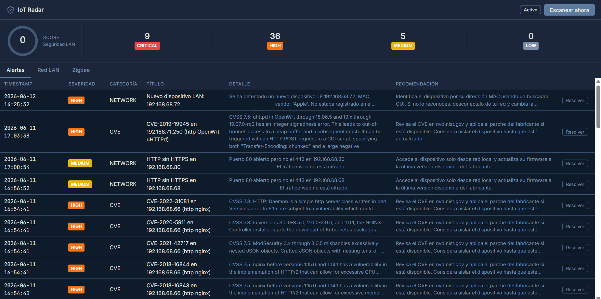
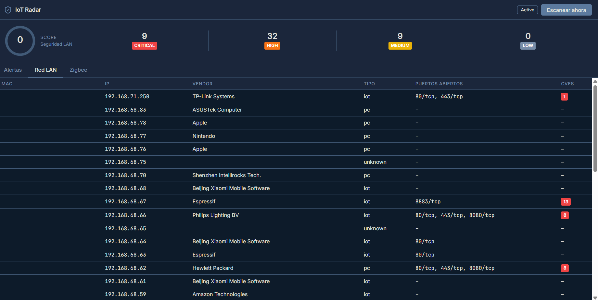
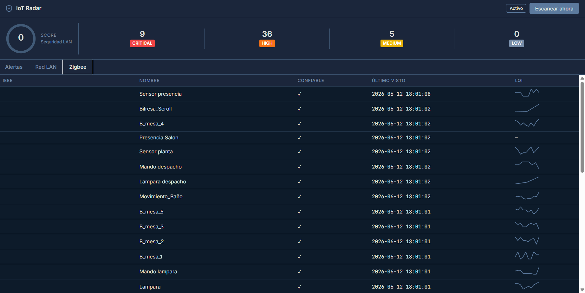

# IoT Radar

[](https://github.com/jrgim/IoT_Radar/actions/workflows/ci.yml)

[](https://my.home-assistant.io/redirect/supervisor_add_addon_repository/?repository_url=https%3A%2F%2Fgithub.com%2Fjrgim%2FIoT_Radar)

Add-on de Home Assistant que vigila la seguridad de una red doméstica con
dispositivos IoT. Analiza tres frentes y muestra los problemas encontrados como
alertas en un panel integrado en la barra lateral de Home Assistant.



| Frente | Qué detecta |
|--------|-------------|
| **MQTT** | Broker que acepta conexiones anónimas, broker sin TLS, floods de mensajes, frontend de Zigbee2MQTT sin `auth_token` |
| **Zigbee** | `permit_join` abierto sin límite de tiempo, network key publicada en claro, dispositivos desconocidos que se unen a la red, señal (LQI) anormalmente baja |
| **LAN** | Dispositivos nuevos, Telnet abierto, HTTP sin HTTPS, credenciales web por defecto, credenciales SSH usadas por Mirai, CVEs conocidos (NVD) en los servicios detectados, IoT y PCs en la misma subred |

Cada alerta incluye una recomendación para resolverla. Las nuevas alertas
aparecen en tiempo real en el panel y como notificación persistente en Home
Assistant.

> Proyecto desarrollado como Trabajo de Fin de Grado.

### Capturas

**Inventario de la red LAN** con fabricante, tipo, puertos abiertos y CVEs por dispositivo:



**Dispositivos Zigbee** con su estado de confianza e histórico de calidad de señal (LQI):



## Requisitos

- Home Assistant OS o Home Assistant Supervised (las instalaciones *Container*
  y *Core* no admiten add-ons).
- Un broker MQTT, por ejemplo el add-on oficial **Mosquitto broker**.
- Opcional: **Zigbee2MQTT** para las comprobaciones Zigbee.
- Arquitecturas: `amd64`, `aarch64`, `armv7`, `armhf`.

## Instalación

1. Pulsa el botón **Añadir repositorio** de arriba, o hazlo a mano:
   **Ajustes → Complementos → Tienda de complementos → ⋮ → Repositorios** y
   añade:

   ```
   https://github.com/jrgim/IoT_Radar
   ```

2. Recarga la tienda, busca **IoT Radar** e instálalo. La primera instalación
   compila la imagen en tu equipo y puede tardar varios minutos (más en una
   Raspberry Pi).
3. En la pestaña **Configuración**, indica el usuario y la contraseña del
   broker MQTT. Si usas el add-on Mosquitto, el host (`core-mosquitto`) ya
   viene configurado.
4. Inicia el add-on y activa **Mostrar en la barra lateral**. El panel se abre
   desde ahí; no hace falta abrir ningún puerto.

Las actualizaciones aparecen automáticamente en Home Assistant cuando se
publica una nueva versión en este repositorio.

## Configuración

```yaml
mqtt_host: core-mosquitto
mqtt_port: 1883
mqtt_user: iot_radar
mqtt_password: "********"
z2m_topic_prefix: zigbee2mqtt
scan_interval_minutes: 60
nvd_api_key: ""
```

| Opción | Descripción |
|--------|-------------|
| `mqtt_host` | Host del broker. Con el add-on Mosquitto, usa `core-mosquitto`. |
| `mqtt_port` | Puerto del broker (`1883` sin TLS). |
| `mqtt_user` / `mqtt_password` | Credenciales del broker. Se recomienda crear un usuario propio para IoT Radar. |
| `z2m_topic_prefix` | Prefijo base de Zigbee2MQTT (`zigbee2mqtt` por defecto). |
| `scan_interval_minutes` | Minutos entre escaneos de la LAN. El primero se lanza ~30 s después de arrancar. También puedes lanzarlo con **Escanear ahora** desde el panel. |
| `nvd_api_key` | Opcional. [API key de NVD](https://nvd.nist.gov/developers/request-an-api-key) para consultar CVEs con un límite de peticiones mucho mayor. |

Más detalle en la pestaña **Documentación** del add-on ([DOCS.md](DOCS.md)).

## Permisos que solicita

El add-on pide permisos amplios porque los necesita para escanear la red:

- `host_network` y `NET_ADMIN` / `NET_RAW`: para que nmap vea la LAN real y
  obtenga las direcciones MAC.
- `homeassistant_api`: para crear notificaciones persistentes en Home Assistant.

## Aviso legal y de uso

> [!CAUTION]
> IoT Radar **escanea puertos y prueba credenciales SSH por defecto** contra los
> dispositivos que encuentra en la subred. Úsalo **solo en redes que sean tuyas o
> en las que tengas autorización expresa**. Escanear redes ajenas puede ser
> ilegal. El software se ofrece tal cual, sin garantía.

## Licencia

[PolyForm Noncommercial 1.0.0](LICENSE.md). Puedes usar, estudiar y modificar
IoT Radar para fines **no comerciales** (uso personal, investigación,
educación). **No está permitido su uso comercial.**

<details>
<summary>El icono del add-on está basado en <code>shield-check</code> de <a href="https://lucide.dev">Lucide</a> (licencia ISC)</summary>

```
Copyright (c) 2026 Lucide Icons and Contributors

Permission to use, copy, modify, and/or distribute this software for any
purpose with or without fee is hereby granted, provided that the above
copyright notice and this permission notice appear in all copies.

THE SOFTWARE IS PROVIDED "AS IS" AND THE AUTHOR DISCLAIMS ALL WARRANTIES
WITH REGARD TO THIS SOFTWARE INCLUDING ALL IMPLIED WARRANTIES OF
MERCHANTABILITY AND FITNESS. IN NO EVENT SHALL THE AUTHOR BE LIABLE FOR
ANY SPECIAL, DIRECT, INDIRECT, OR CONSEQUENTIAL DAMAGES OR ANY DAMAGES
WHATSOEVER RESULTING FROM LOSS OF USE, DATA OR PROFITS, WHETHER IN AN
ACTION OF CONTRACT, NEGLIGENCE OR OTHER TORTIOUS ACTION, ARISING OUT OF
OR IN CONNECTION WITH THE USE OR PERFORMANCE OF THIS SOFTWARE.
```

</details>

## Desarrollo

Estructura del repositorio:

```
config.yaml            # definición del add-on para Home Assistant
Dockerfile
run.sh                 # lee las opciones del add-on y arranca la app
app/                   # FastAPI + monitor MQTT + escáner
tests/                 # tests con pytest
docker-compose.yml     # entorno de desarrollo local
```

`main.py` (FastAPI) arranca dos hilos: uno escucha el broker MQTT y otro escanea
la red con nmap. Ambos generan alertas a través de `alert_engine`, que las guarda
en SQLite, las envía al panel por WebSocket y las notifica a Home Assistant.

**Ejecutar en local** (requiere Linux: el escaneo necesita el modo de red *host*
de Docker):

```bash
cp .env.example .env    # y rellena los datos de tu broker
docker compose up --build
```

Panel en `http://localhost:8099`.

**Tests:**

```bash
pip install -r requirements.txt pytest
pytest
```
